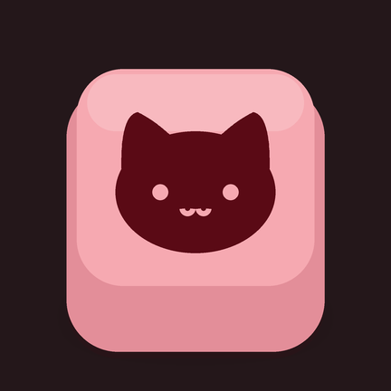

# iPurrboard



**iPurrboard** is a keyboard for Android with the look, feel and typing behaviour of the iPhone
keyboard, plus a few extras people love from Gboard. It's written from scratch in Kotlin on plain
Android framework views: no AndroidX, no third-party runtime libraries, no ads, no tracking.

> **Beta.** iPurrboard is a hobby project in active development. Expect rough edges, and
> please [open an issue](https://github.com/leconnn/iPurrboard/issues) if something breaks.
>
> Not affiliated with or endorsed by Apple or Google.

## Download

Get the latest APK from [Releases](https://github.com/leconnn/iPurrboard/releases), then:

1. Open the APK on your phone and allow installing apps from your browser or file manager if asked.
2. Open **iPurrboard**. A short welcome walks you through turning it on in Android's keyboard list,
   selecting it, and picking its look, layout and a few extras (all changeable later in Settings).
3. Use **Try It** at the top of Settings to test it right away.

After that, iPurrboard updates itself: when a new version is out, Settings shows **Software Update
Available** (and the keyboard mentions it once). Tap **Download and Install** and confirm.

Requires Android 8.0 or newer. The Glass look's background blur needs Android 12 or newer.

## Features

**Typing**
- iPhone key layout and sizes, key previews, long-press accents, caps lock and auto-capitalisation.
- Predictive text, autocorrection that learns from you, Check Spelling and inline predictions.
- Slide to type, a space-bar trackpad, Smart Punctuation, the "." shortcut and text replacements.
- Select text and press Shift to change its case: lowercase, Title Case, ALL CAPS, then back.
- Shows Math Results as you type a sum (`12*4=`).

**Look**
- **Glass** (translucent, blurred, rounded) or **Classic** appearance, light or dark. Glass has
  iOS 27's **Tint Amount** slider (More Clear to More Tinted) and **Show Borders**.
- **Standard** (iPhone) or **Extended** key layout, the latter with comma and period keys and
  long-press symbol hints.
- Optional number row, one-handed mode and adjustable keyboard height.
- A settings app laid out like iOS Settings, with the same Keyboard page, swipe-back navigation
  and iOS-style switches and sliders.
- A short intro on launch: the keycap logo gets pressed, pops and the name types itself in
  (tap to skip; off when Android's animations are turned off).

**Extras**
- **Paste suggestion:** what you just copied appears above the keys ("paste from Threads"); tap to
  paste. Recent screenshots too, if you allow it.
- **Clipboard history** with pinning, as a list or a grid of cards.
- **Emoji panel** with search, skin tones and emoji suggestions while you type.
- **Emoji Kitchen** stickers (optional; the pictures load from Google's servers).
- **Toolbar** with emoji, clipboard, text editing (arrows, select, copy, paste) and voice typing.
- Physical keyboard support.

Most extras are off at first, as on the iPhone; turn them on in Settings.

## Privacy

What you type never leaves your phone. iPurrboard has no accounts, analytics, ads or crash
reporting. Learned words, clipboard history and settings are stored only on your device and are
not backed up. It learns nothing in password fields or incognito fields. It goes online only to
check GitHub for a new version once a day (you can turn that off) and for Emoji Kitchen stickers, if
you turn them on.

Read the full [privacy policy](PRIVACY.md) (also in the app: Settings > Privacy Policy).

## Build from source

You need JDK 17 and the Android SDK (compile SDK 36).

```sh
./gradlew assembleRelease    # app/build/outputs/apk/release/iPurrboard-<version>-release.apk
./gradlew test               # unit tests
```

To sign release builds, add a `keystore.properties` file (gitignored) next to `build.gradle.kts`
with `storeFile`, `storePassword`, `keyAlias` and `keyPassword`.

## Project layout

```
app/src/main/java/dev/leconnn/ioskeyboard/
  IosKeyboardService.kt   the input method: keys, suggestions, clipboard, languages
  KeyboardView.kt         drawing and touch handling for keys, bar, panels and popups
  KeyboardLayout.kt       key geometry, the number row, accents
  SettingsActivity.kt     the settings app (pages on an iOS-style navigation stack)
  ui/                     iOS controls: grouped lists, switch, slider, navigation stack
  text/                   dictionaries, prediction, correction, slide to type, learning
  emoji/                  the emoji panel
app/src/main/assets/      word lists, next-word data, emoji names and search
tools/                    scripts that build the assets from their sources
```

## Known limitations

- The keyboard's Glass corners show whatever the app draws behind the keyboard; in apps with a
  plain black background they look dark.

## License

The source code is released under the [MIT License](LICENSE). The word lists and other data files
in `app/src/main/assets` are adaptations of the works credited below and stay under their own
licences.

## Credits and licences

- **Word list:** adapted from [hermitdave/FrequencyWords](https://github.com/hermitdave/FrequencyWords)
  (`en_50k`, OpenSubtitles 2018) by Hermit Dave,
  [CC BY-SA 4.0](https://creativecommons.org/licenses/by-sa/4.0/). The filtered
  `assets/dict/en.tsv` is shared under the same licence.
- **Additional word list:** `assets/dict/tl.tsv` combines FrequencyWords `tl` (OpenSubtitles 2018,
  CC BY-SA 4.0, Hermit Dave), the [Tatoeba Project](https://tatoeba.org)'s Tagalog sentences
  (CC BY 2.0 FR) and the [Leipzig Corpora Collection](https://wortschatz.uni-leipzig.de)'s
  `tgl_wikipedia_2021_100K` ([CC BY 4.0](https://creativecommons.org/licenses/by/4.0/)). Shared
  under CC BY-SA 4.0.
- **Next-word predictions:** word pairs counted from the [Tatoeba Project](https://tatoeba.org)'s
  sentences, [CC BY 2.0 FR](https://creativecommons.org/licenses/by/2.0/fr/).
- **Offensive-word lists:** adapted from
  [LDNOOBW](https://github.com/LDNOOBW/List-of-Dirty-Naughty-Obscene-and-Otherwise-Bad-Words)
  (`en` and `fil`), [CC BY 4.0](https://creativecommons.org/licenses/by/4.0/), Shutterstock, Inc.
  and contributors, with a few additions.
- **Emoji data, names and search:** Unicode's `emoji-test.txt` and CLDR annotations,
  [Unicode License](https://www.unicode.org/license.txt).
- **Emoji Kitchen:** the index of which pairs exist comes from
  [xsalazar/emoji-kitchen-backend](https://github.com/xsalazar/emoji-kitchen-backend); the sticker
  artwork is Google's and is loaded from its servers, not included.
- **Gboard** was studied as a reference for features. No Gboard code or assets are included.
- **Trademarks:** iPhone and iOS are trademarks of Apple Inc.; Gboard is a trademark of Google LLC.
  iPurrboard is an independent project, not affiliated with or endorsed by either.
